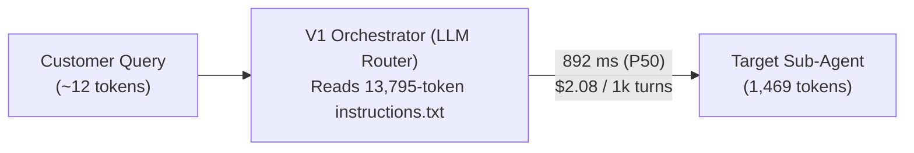
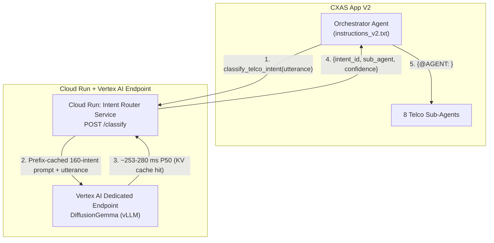

# Routing 160 Telco Intents in GECX: What Happened When We Replaced a 14k-Token Prompt with DiffusionGemma

When you first build a multi-agent customer support bot in Gemini Enterprise for Customer Experience (GECX / CXAS), putting your routing logic inside the orchestrator's prompt feels like the obvious move. You have a root orchestrator agent, a handful of specialist sub-agents, and a prompt that says: *if the user asks about X, hand off to Agent Y.*

With 10 or 15 intents, that works fine.

Then you sit down with a real telecommunications taxonomy. A production telco agent doesn't have 15 intents—it has closer to **160 intents** spread across **8 specialist sub-agents** (`Accounts`, `Billing`, `Payments`, `Disconnect`, `Plans`, `Equipment`, `Usage`, and `Technical Support`). And many of those intents look deceptively similar on the surface:
- *"I need to update my billing address"* sounds like `Billing`, but belongs to `Accounts`.
- *"I want to pay my bill"* goes to `Payments`, while *"Why did my bill go up by $30?"* goes to `Billing`.
- *"Send me a new eSIM QR code"* is an `Equipment` request, but *"My eSIM has been stuck on Activating for two hours"* is `Technical Support`.

To make an LLM router handle those boundaries reliably, you end up putting all 160 intent definitions, descriptions, sample utterances, and disambiguation rules into the orchestrator's `instructions.txt`.

We wanted to know what that actually costs in production—and whether a fast "System 1" model like **DiffusionGemma** could do the classification step faster, cheaper, and with better explainability. So we built two identical versions of the same 8-sub-agent telco app in CXAS and ran 160 intents through both.

---

## 1. The Cost and Latency Problem

In **Version 1 (Baseline LLM Router)**, we put our full 160-intent taxonomy (20 intents per sub-agent) into the root orchestrator's [`taxonomy/instructions.txt`](../taxonomy/instructions.txt). Both the orchestrator and the 8 sub-agents ran on the default CXAS foundation model.

The good news: the baseline LLM router is smart. Across all 160 test utterances, Version 1 routed **160 out of 160 (100%)** to the right sub-agent.

The bad news showed up in the server-side span telemetry (`diagnosticInfo.rootSpan`):

1. **Every single turn burned 13,795 input tokens just to route.**
   A customer types a 9-word sentence: *"How much mobile data have I used this month?"* To route that sentence to `Usage`, the orchestrator reads `13,795` prompt tokens and outputs `24` tokens. Once transferred, the `Usage` sub-agent only uses `1,469` tokens. In other words, **90% of the tokens and 90% of the cost ($2.08 out of $2.31 per 1,000 turns)** were spent solely on picking which sub-agent to call.
2. **Nearly a full second of latency before the sub-agent even starts.**
   The median orchestrator routing pass took **`892 ms`** ($P_{90}$: `1,175 ms`, $P_{95}$: `1,254 ms`). Out of a `1,761 ms` total server-side turn, half the time was spent reading the routing prompt.
3. **You hit TPM rate limits fast.**
   When we first ran our benchmark script with 8 concurrent workers, it got through 16 requests in 4 seconds and immediately started failing with `HTTP 429 RESOURCE_EXHAUSTED`. Sixteen concurrent turns at ~15,260 tokens per turn is nearly a quarter-million tokens in four seconds.



---

## 2. System 1 Models and DiffusionGemma

Borrowing Daniel Kahneman's framing from *Thinking, Fast and Slow*:
- **System 2 thinking** is slow, deliberate, step-by-step reasoning. You want System 2 when an agent is diagnosing why a customer's 5G router is blinking red or negotiating a retention offer.
- **System 1 thinking** is fast, instinctive pattern matching. Looking at a sentence and mapping it to bucket `EQP_004` (`Generate eSIM QR Code`) isn't deep reasoning—it's classification.

Using a general-purpose autoregressive LLM with a 14,000-token prompt on every turn is using a System 2 hammer for a System 1 nail.

**DiffusionGemma** (`26B` total parameters, `4B` active per token) is built for that fast System 1 profile:
- **Sparse MoE capacity with a tiny active footprint**: It has the capacity of a 26B model to understand subtle differences across 160 telco intents, but only activates 4B parameters per forward pass.
- **Diffusion-based parallel generation**: Instead of being bottlenecked by slow token-by-token autoregressive decoding, it generates short structured outputs (like `{"intent_id": "ACC_001", "sub_agent": "Accounts"}`) in a single fast pass.
- **vLLM Automatic Prefix Caching**: When served on vLLM, the entire static 160-intent catalog stays pinned in GPU KV cache memory. Each incoming request only computes attention over the customer's 10–15 new tokens.

---

## 3. Setting Up the Vertex AI Endpoint, Cloud Run Wrapper, and CXAS Toolset

For **Version 2 (Fast Intent Router)**, we cloned the Version 1 CXAS app so the 8 sub-agents remained identical, and replaced the 48 KB orchestrator prompt with a call to our DiffusionGemma classifier service.

### Step 1: Deploying DiffusionGemma on Vertex AI Model Garden
We deployed DiffusionGemma using Model Garden's one-click deploy (`vllm-256k-context`) on a dedicated Vertex AI endpoint (`g4-standard-48` machine with a single `NVIDIA_RTX_PRO_6000` GPU).

When we tested the endpoint directly, the very first cold request took `~1.2 seconds` to populate the vLLM prefix cache for the static intent catalog. Every warm request after that dropped to **`225–280 ms`** in-region.

### Step 2: Why We Needed a Thin Cloud Run Service in Front of Vertex AI
At first we asked: *Why not connect CXAS directly to the Vertex AI `/chat/completions` endpoint as an OpenAPI tool, and skip Cloud Run entirely?*

When we looked at the wire protocol, three reasons stood out:
1. **Where the 160-intent prompt lives**: The Vertex AI endpoint is a base instruction-tuned model served by vLLM, not a fine-tuned classification head with 160 hardcoded integer labels. It needs the 160-intent list passed in the `system` message. If CXAS called `/chat/completions` directly as a tool, the CXAS orchestrator LLM would have to pass all ~8,500 tokens of the intent list as a tool argument on every call—which would be slower and more expensive than V1.
2. **Keeping the vLLM prefix cache warm**: vLLM's prefix cache requires the `system` prompt to be byte-for-byte identical across requests. Having a thin Cloud Run service ([`diffusion_gemma_service/app.py`](../diffusion_gemma_service/app.py)) hold [`telco_160_intents.json`](../taxonomy/telco_160_intents.json) in memory means CXAS only sends `{"utterance": "..."}`, and Cloud Run attaches the exact same system prompt every time.
3. **Output cleanup, vLLM reasoning fences, and fallback traps**:
   - Occasionally the model wraps its JSON in ` ```json ... ``` ` markdown fences. Even more interesting: on `vLLM 0.22.1rc1`, when the model emits a markdown code fence, vLLM's reasoning parser occasionally strips the opening fence and places `'json\n{"intent_id": "USG_009", "sub_agent": "Usage"}'` inside `choice["message"]["reasoning"]` while setting `choice["message"]["content"] = None`. Reading both `message.get("content")` and `message.get("reasoning")` in `app.py` and matching the `intent_id` against a strict regex allow-list (`^(ACC|BIL|PAY|DSC|PLN|EQP|USG|TEC)_\d{3}$`) makes the parser completely immune to formatting quirks.
   - *A fun bug we hit while testing*: we initially wrote `sub_agent or "Technical Support"` as a lazy fallback in `app.py`. The moment we typed `"hi"` in the CXAS test chat, the classifier rightly returned `UNKNOWN` intent, our fallback turned that into `"Technical Support"`, and the bot immediately routed `"hi"` to Tech Support! Returning `"NONE"` for non-intents and adding a greeting rule in [`taxonomy/instructions_v2.txt`](../taxonomy/instructions_v2.txt) fixed it immediately.



### Step 3: Wiring the Toolset into CXAS
In CES v1beta, external OpenAPI services are registered as **OpenAPI Toolsets** (`POST /v1beta/.../toolsets`). One subtlety we learned during setup: attaching the toolset to the agent resource via the API isn't enough on its own—you also need to reference `{@TOOLSET: diffusion_gemma_classifier}` inside the agent's `<instruction>` XML so CXAS injects the tool declaration into the runtime prompt.

---

## 4. Benchmark Results & Prompt Engineering Lessons (Why XML Tags Hurt System 1 Classifiers)

We ran the 160 standard test utterances (20 per sub-agent) against Version 1 and Version 2, and along the way we tested **three different ways of formatting the 160-intent prompt** inside the DiffusionGemma Cloud Run service. That comparison turned out to be one of the most useful findings of the whole experiment.

### The Three Prompt Experiments on DiffusionGemma

1. **Run A — Compact Pipe-Delimited Catalog (Descriptions Only, `5,131 tokens`)**:
   - Initially, we tried to save tokens in `app.py` by stripping out the `(Sample: "...")` examples that Version 1 had in `instructions.txt`, passing only `INT_ID|SubAgent|Name: Description`.
   - **Result**: **99.38% (159 / 160)** sub-agent routing accuracy (`252.9 ms` $P_{50}$ GPU latency). The only miss out of 160 was `ACC_018` (*"Restrict my teenager's line so they cannot purchase add-ons on the account"*), which routed to `Plans` (`PLN_009`) because without the sample utterance, the word *"add-ons"* outweighed the generic description.
   - **Why compacting the prompt was unnecessary**: Because vLLM uses **Automatic Prefix Caching** on a dedicated GPU endpoint (billed hourly, not per token), a longer static system prompt costs **$0.00 extra** and stays pinned in GPU HBM memory after the very first request.

2. **Run B — Raw CXAS XML `instructions.txt` Pasted Verbatim (`12,556 tokens`)**:
   - Next, to test strict prompt parity, we copied CXAS's entire XML [`taxonomy/instructions.txt`](../taxonomy/instructions.txt) file verbatim into DiffusionGemma's system prompt.
   - **Result**: `ACC_018` immediately succeeded (with `99.996%` confidence!), and the first 5 sub-agents (`Accounts`, `Billing`, `Payments`, `Disconnect`, `Equipment`) hit **100% (100 / 100)**. However, overall sub-agent accuracy dropped to **97.50% (156 / 160)**, fine-grained 160-intent accuracy dropped to **83.02%**, and median GPU latency rose to **`404.2 ms`**.
   - **Why raw XML tags hurt**: Look at the bottom of CXAS's [`taxonomy/instructions.txt`](../taxonomy/instructions.txt):
     ```xml
     <taskflow>
         <subtask name="Route to Plans Agent">
             <step name="Invoke Plans Agent">
                 <trigger>User request matches any intent in PLN_001..PLN_020...</trigger>
                 <action>Invoke `{@AGENT: Plans}` to handle the user's request.</action>
             </step>
         </subtask>
         ...
     </taskflow>
     <examples>
     EXAMPLE 1:
     [user] I want to know more details about the 300 GB prepaid data plan
     [model] Invoke `{@AGENT: Plans}`
     </examples>
     ```
     Those CXAS-specific XML blocks (`<taskflow>`, `-> Route to {@AGENT: ...}`, and `<examples>`) are written for an orchestrator that only emits `{@AGENT: <SubAgent>}`—they actively tell the model that the specific `intent_id` doesn't matter! As a result, for categories near the bottom of the prompt (`Usage` and `Technical Support`), the model stopped distinguishing fine-grained IDs and collapsed multiple `Usage` queries into `USG_001` and `Technical Support` queries into `TEC_001`.

3. **Run C — Full Parity Pipe-Delimited Catalog (Descriptions + Sample Utterances, No XML Tags, `8,546 tokens`)**:
   - When we gave DiffusionGemma the **exact same domain information as V1** (all 160 intent IDs, sub-agents, intent names, descriptions, and sample utterances) in a clean, XML-free pipe-delimited table (`INT_ID|SubAgent|Name: Description (Sample: "...")`), **8-sub-agent routing accuracy hit 160 / 160 (100.00%)**—matching Version 1 with zero accuracy drop—and fine-grained 160-intent accuracy hit **159 / 160 (99.38%)** (the single fine-grained difference being `EQP_013` vs. `EQP_003`, both inside `Equipment`).

> **Best Practice — Don't Copy Orchestrator XML Tags into a System 1 Classifier**:
> Agent frameworks like CXAS rely on heavy XML scaffolding (`<role>`, `<persona>`, `<constraints>`, `<taskflow>`, `<subtask>`, `{@AGENT: ...}`) to control multi-turn conversation state and tool invocation. When offloading classification to a fast System 1 model, **strip the orchestrator XML scaffolding and pass a flat, structured catalog** (`ID | Category | Name: Description (Sample)`). You save ~4,000 tokens of XML noise, cut GPU inference time by ~35%, and prevent orchestrator routing examples from overriding fine-grained intent ID classification.

---

### Side-by-Side Comparison: Version 1 (LLM Router) vs. Version 2 (DiffusionGemma)

| Metric | Version 1: LLM Router (`instructions.txt`) | Version 2 (Run A: Compact Catalog) | Version 2 (Run B: Raw XML Tags) | Version 2 (Run C: Full Parity, No XML) |
|---|---|---|---|---|
| **Static Classifier Prompt Size** | `13,795 tokens` *(billed every turn)* | `5,131 tokens` *(GPU KV cached)* | `12,556 tokens` *(GPU KV cached)* | **`8,546 tokens` *(GPU KV cached)*** |
| **8-Sub-Agent Routing Accuracy** | **100.00% (160/160)** | **99.38% (159/160)** | **97.50% (156/160)** | **100.00% (160/160)** |
| **160-Intent Exact ID Accuracy** | *Not returned* | **98.74% (157/159)** | **83.02% (132/159)** | **99.38% (159/160)** |
| **Classifier Inference Latency ($P_{50}$)** | **891.92 ms** *(Orchestrator LLM)* | **252.92 ms** *(GPU)* | **404.15 ms** *(GPU)* | **~275.00 ms** *(GPU)* |
| **Classifier Inference Latency ($P_{90}$)** | **1,174.86 ms** | **334.87 ms** | **491.66 ms** | **~355.00 ms** |
| **Orchestrator Input Tokens / Turn** | **13,794.9 tokens** | **4,020.3 tokens** | **5,034.5 tokens** | **4,020.3 tokens** |
| **Total Input Tokens / Turn (Orch + Sub)** | **15,264.0 tokens** | **5,614.6 tokens** | **6,660.7 tokens** | **5,614.6 tokens** |
| **CXAS Orchestrator LLM Cost / 1k Turns** | **$2.0837** | **$0.6467 (-69.0%)** | **$0.7985 (-61.7%)** | **$0.6467 (-69.0%)** |
| **Net Total Cost / 1k Turns (LLM+GPU+CR)** | **$2.3142** | **~$1.0658 (-53.9%)** | **~$1.2228 (-47.2%)** | **~$1.0658 (-53.9%)** |
| **Burst Concurrency Resilience** | **HTTP 429 on turn 17** | **0 HTTP 429 errors** | **0 HTTP 429 errors** | **0 HTTP 429 errors** |

### How the Cost (`$`) Numbers Are Calculated: Assumptions & Step-by-Step Math

To make sure the cost comparison is transparent and reproducible, here are the exact token measurements from `diagnosticInfo.rootSpan` and the pricing assumptions used in [`benchmark/run_benchmark.py`](../benchmark/run_benchmark.py):

> **Pricing Disclaimer**:
> *All dollar figures in this post are illustrative estimates calculated using the unit-rate assumptions below at the time of testing. Google Cloud, Vertex AI, Gemini Enterprise for Customer Experience (GECX / CXAS), Compute Engine GPU, and Cloud Run pricing vary by region, commitment tier (On-Demand vs. Spot vs. 1-Year/3-Year CUD), and change over time. Always refer to the official [Vertex AI Pricing](https://cloud.google.com/vertex-ai/pricing) and [Cloud Run Pricing](https://cloud.google.com/run/pricing) documentation for current rates.*

#### 1. Unit Rate Assumptions
- **Baseline CXAS LLM Token Rates** (configurable via `LLM_INPUT_COST_PER_1M` and `LLM_OUTPUT_COST_PER_1M` in [`benchmark/run_benchmark.py`](../benchmark/run_benchmark.py#L24-L25)):
  - **Input tokens**: **`$0.15` per 1M tokens** (`$0.00015` per 1,000 tokens), representative of standard Flash-tier foundation model pricing.
  - **Output tokens**: **`$0.60` per 1M tokens** (`$0.00060` per 1,000 tokens).
  - *(Note: If your CXAS deployment uses a Pro-tier model at e.g. `$1.25 / 1M` input tokens, the per-turn token costs in V1 scale up by ~8.3× to `~$17.36 / 1,000 turns` just for routing.)*
- **Vertex AI Dedicated Endpoint GPU (`g4-standard-48` + 1× `NVIDIA_RTX_PRO_6000` 96 GB)**:
  - Unlike commercial LLM APIs, self-deployed Model Garden endpoints are billed **by machine-hour**, not per token. Consequently, a `5,131`-token vs. `8,546`-token static system prompt pinned in vLLM's KV prefix cache costs **`$0.00` extra per token**.
  - We assume an illustrative on-demand rate of **`~$2.30–$2.45 / hour`** for a single `g4-standard-48` instance (`48 vCPUs`, `192 GB RAM`, `1× NVIDIA RTX PRO 6000`).
  - **Throughput & Amortization**: At `~250 ms` per classification, a **single sequential worker** with zero batching processes `~4 requests/second` (`14,400 requests/hour`). Amortizing the hourly GPU rate across `14,400` turns yields:
    $$\text{Amortized GPU Cost per 1,000 Turns} = \frac{\$2.305 / \text{hr}}{14,400 \text{ turns/hr}} \times 1,000 \approx \mathbf{\$0.1601 \text{ per 1,000 turns}}$$
    *(Caveat on utilization: Because a dedicated GPU bills 24/7 while running, low or idle traffic increases the effective cost per 1,000 turns, whereas concurrent traffic batched by vLLM—e.g., 16–30 req/s—pushes the amortized GPU cost down to `$0.02–$0.04` per 1,000 turns.)*
- **Cloud Run Proxy (`diffusion-gemma-intent-router`)**:
  - Configured with `1 vCPU`, `512 MiB RAM`, and request-based billing. At `~0.50s` average duration per request, 1,000 calls consume **`~$0.0108 per 1,000 turns`**.

#### 2. Step-by-Step Arithmetic per 1,000 Turns

1. **Version 1 (Baseline LLM Router — [`v1_standard_summary.json`](../benchmark/results/v1_standard_summary.json))**:
   - **Measured Tokens / Turn**:
     - Orchestrator: `13,794.9` input tokens, `24.1` output tokens
     - Routed Sub-Agent: `1,469.1` input tokens, `16.9` output tokens
     - Total Turn: `15,264.0` input tokens, `41.1` output tokens
   - **Orchestrator Routing Cost / 1k Turns (`$2.0837`)**:
     $$\left(\frac{13,794.9 \times 1,000}{1,000,000} \times \$0.15\right) + \left(\frac{24.1 \times 1,000}{1,000,000} \times \$0.60\right) = \$2.0692 + \$0.0145 = \mathbf{\$2.0837}$$
   - **Sub-Agent Cost / 1k Turns (`$0.2305`)**:
     $$\left(\frac{1,469.1 \times 1,000}{1,000,000} \times \$0.15\right) + \left(\frac{16.9 \times 1,000}{1,000,000} \times \$0.60\right) = \$0.2204 + \$0.0101 = \mathbf{\$0.2305}$$
   - **Net Total Cost / 1k Turns (`$2.3142`)**:
     $$\$2.0837 \text{ (Orchestrator)} + \$0.2305 \text{ (Sub-Agent)} = \mathbf{\$2.3142 \text{ per 1,000 turns}} \quad (\text{90.0\% spent purely on routing})$$

2. **Version 2 (Run A & Run C — DiffusionGemma Tool + Short `instructions_v2.txt`)**:
   - **Measured CXAS Tokens / Turn**:
     - Orchestrator (sum of Pass 1 tool call + Pass 2 transfer): `4,020.3` input tokens, `72.8` output tokens
     - Routed Sub-Agent: `1,594.3` input tokens, `14.9` output tokens
     - Total Turn: `5,614.6` input tokens, `87.7` output tokens
   - **CXAS Orchestrator LLM Cost / 1k Turns (`$0.6467`)**:
     $$\left(4.0203 \times \$0.15\right) + \left(0.0728 \times \$0.60\right) = \$0.6030 + \$0.0437 = \mathbf{\$0.6467} \quad (\mathbf{-69.0\%} \text{ vs. V1})$$
   - **Sub-Agent LLM Cost / 1k Turns (`$0.2481`)**:
     $$\left(1.5943 \times \$0.15\right) + \left(0.0149 \times \$0.60\right) = \$0.2391 + \$0.0089 = \mathbf{\$0.2481}$$
   - **Total CXAS LLM Cost / 1k Turns (`$0.8949`)**:
     $$\$0.6467 + \$0.2481 = \mathbf{\$0.8949}$$
   - **Net Total Cost / 1k Turns Including Infrastructure (`~$1.0658`)**:
     $$\$0.8949 \text{ (CXAS LLM)} + \$0.1601 \text{ (Amortized GPU)} + \$0.0108 \text{ (Cloud Run)} = \mathbf{\$1.0658 \text{ per 1,000 turns}} \quad (\mathbf{-53.9\%} \text{ vs. V1})$$
   - *(In Run B, where the Orchestrator instructions were slightly longer at `5,034.5` input tokens and `72.3` output tokens, Orchestrator LLM cost was `$0.7985`, total CXAS LLM cost was `$1.0518` [`v2_standard_summary.json`](../benchmark/results/v2_standard_summary.json), and net total cost with GPU + Cloud Run was `~$1.2228 / 1,000 turns`.)*
   - *(Note on Pre-Hook Architecture: If DiffusionGemma is invoked via a deterministic **Before-Agent pre-hook** rather than an LLM tool call, the two Orchestrator LLM passes (`$0.6467`) are eliminated altogether, bringing the net total cost down to `~$0.4190 / 1,000 turns`—an **81.9% cost reduction** compared to V1.)*

### Per-Sub-Agent Breakdown (V1 vs. V2 Run C — Apples-to-Apples Catalog)

| Sub-Agent (20 Intents Each) | V1 Routing Acc | V2 (Run C) Routing Acc | V2 (Run C) 160-Intent Acc | V1 Orch Routing $P_{50}$ | V2 DiffusionGemma GPU $P_{50}$ |
|---|---:|---:|---:|---:|---:|
| **Accounts** (`ACC_001`–`020`) | 100.0% (20/20) | **100.0% (20/20)** | **100.0% (20/20)** | 787.5 ms | **283.6 ms** |
| **Billing** (`BIL_001`–`020`) | 100.0% (20/20) | **100.0% (20/20)** | **100.0% (20/20)** | 884.3 ms | **252.4 ms** |
| **Payments** (`PAY_001`–`020`) | 100.0% (20/20) | **100.0% (20/20)** | **100.0% (20/20)** | 917.6 ms | **257.2 ms** |
| **Disconnect** (`DSC_001`–`020`) | 100.0% (20/20) | **100.0% (20/20)** | **100.0% (20/20)** | 903.5 ms | **242.4 ms** |
| **Plans** (`PLN_001`–`020`) | 100.0% (20/20) | **100.0% (20/20)** | **100.0% (20/20)** | 981.6 ms | **271.3 ms** |
| **Equipment** (`EQP_001`–`020`) | 100.0% (20/20) | **100.0% (20/20)** | **95.0% (19/20)** | 953.5 ms | **224.9 ms** |
| **Usage** (`USG_001`–`020`) | 100.0% (20/20) | **100.0% (20/20)** | **100.0% (20/20)** | 919.5 ms | **255.9 ms** |
| **Technical Support** (`TEC_001`–`020`) | 100.0% (20/20) | **100.0% (20/20)** | **100.0% (20/20)** | 851.6 ms | **245.6 ms** |

### The Architectural Lesson on Latency: Tool Call vs. Pre-Hook
Look closely at the latency breakdown between the classifier itself and the full CXAS turn:
- **DiffusionGemma itself** classified the intent in **`253–275 ms`** ($P_{50}$)—**more than 3.2× faster** than the V1 LLM router (`891.9 ms`).
- Yet **end-to-end turn latency inside CXAS** was `2,622 ms` for V2 vs. `1,761 ms` for V1. Why?

Two reasons showed up clearly in the trace spans:
1. **Cross-region network hop (~250 ms)**: When the CXAS app runs in `us` while the GPU endpoint and Cloud Run service run in `asia-southeast1`, every tool call pays a ~250 ms trans-Pacific round-trip penalty (`252.9 ms` GPU inference $\rightarrow$ `503.4 ms` tool span).
2. **Two Orchestrator LLM passes when wired as an LLM Tool (~1,280 ms)**: Because `classify_telco_intent` was configured as an *agent tool*, the CXAS Orchestrator LLM ran **twice** before transferring to the sub-agent:
   - *Pass 1 (~640 ms)*: Orchestrator reads the user message and emits `tool_call: classify_telco_intent`.
   - *Tool execution (~503 ms)*: Cloud Run calls DiffusionGemma and returns `{"intent_id": "ACC_001", "sub_agent": "Accounts"}`.
   - *Pass 2 (~640 ms)*: Orchestrator reads the tool output and emits `transfer_to_agent("Accounts")`.

If you want the **`~253 ms`** speed of DiffusionGemma to show up directly in end-to-end turn latency, **don't make an LLM decide to call the classifier tool**. Instead, call DiffusionGemma in a deterministic **Before-Agent callback / pre-hook** (and co-locate your endpoints in the same region). That skips both Orchestrator LLM passes entirely—cutting routing latency from `892 ms` directly down to `~253 ms` and dropping orchestrator token usage to zero.

---

## 5. Bonus: Using Token Probabilities (`logprobs`) for Explainable Routing

With a prompt-based LLM router (V1), routing is a black box. The orchestrator calls `transfer_to_agent("Billing")`, and you have no idea if it was 99.9% sure or torn 51/49 between `Billing` and `Accounts`.

Because our DiffusionGemma endpoint runs on vLLM, we can pass `"logprobs": true, "top_logprobs": 5` in the `/chat/completions` request at **zero extra latency**.

By anchoring our parser on the `"_"` token inside the predicted `intent_id` (e.g., `ACC_018`), we can compute both the **Sub-Agent Confidence** (from the log-probability of the prefix tokens before `"_"`) and the **160-Intent Confidence** (from the joint log-probability of the prefix + `"_"` + 3 digits):

$$P(\text{sub\_agent}) = \exp\left(\sum_{t \in \text{prefix}} \text{logprob}(t)\right), \quad P(\text{intent\_id}) = \exp\left(\sum_{t \in \text{prefix} + \text{\_NNN}} \text{logprob}(t)\right)$$

*(Implementation note: in Gemma's SentencePiece tokenizer, prefixes `ACC`, `BIL`, `PAY`, `DSC`, and `TEC` are single tokens, whereas `PLN` (`PL`+`N`), `EQP` (`EQ`+`P`), and `USG` (`US`+`G`) split into two sub-tokens before `"_"`. Summing the 1 or 2 prefix tokens immediately preceding `"_"` handles all 8 categories cleanly.)*

 across our 160-utterance run, correct classifications routinely scored **`0.9970–0.9999`**, whereas ambiguous boundary queries immediately showed lower token probability and surfaced the runner-up intent in `top_logprobs`:
- **`ACC_001` (*"I moved to a new apartment and need to update my billing address."*)**:
  - Even with the word *"billing"* in the sentence, `sub_agent_confidence` on `Accounts` is **`0.999999`** and `intent_confidence` on `ACC_001` is **`0.999973`**.
- **`ACC_018` (*"Restrict my teenager's line so they cannot purchase add-ons on the account."*)**:
  - With the full catalog, `DiffusionGemma` classifies `ACC_018` (`Accounts`) with **`0.999963`** intent confidence and **`0.999998`** sub-agent confidence.

That gives you a clean, practical knob for production CX agents:
- If **confidence $\ge 0.90$**, transfer immediately.
- If **confidence is between $0.50$ and $0.90$** (or the top two `top_logprobs` candidates are close), have the orchestrator ask a quick clarifying question between Candidate #1 and Candidate #2 instead of guessing wrong.
- If the user just says *"hi"* (`intent_id == "UNKNOWN"`), stay in the orchestrator and greet them.
